# TalentConnect - PlantUML Activity Diagrams

## 1. User Authentication Flow

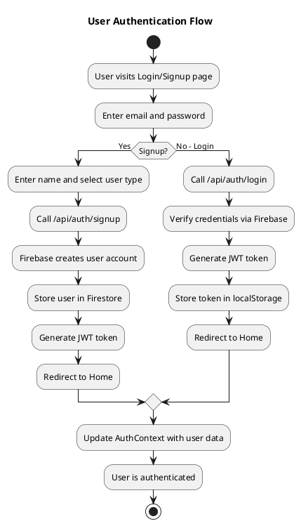

---

## 2. Event Browsing & Discovery

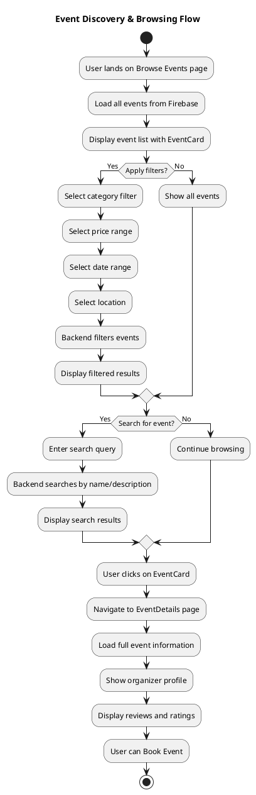

---

## 3. Event Booking & Payment

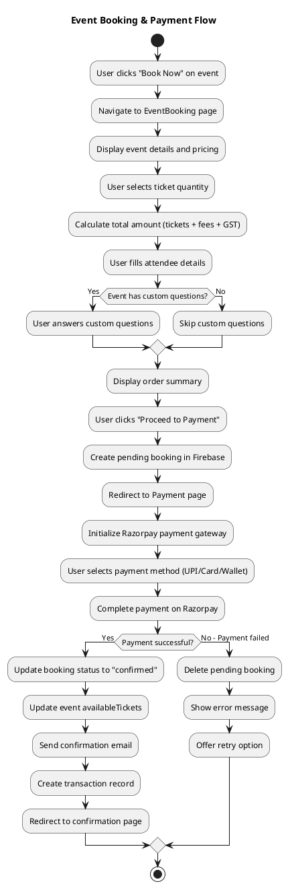

---

## 4. Organizer Event Creation

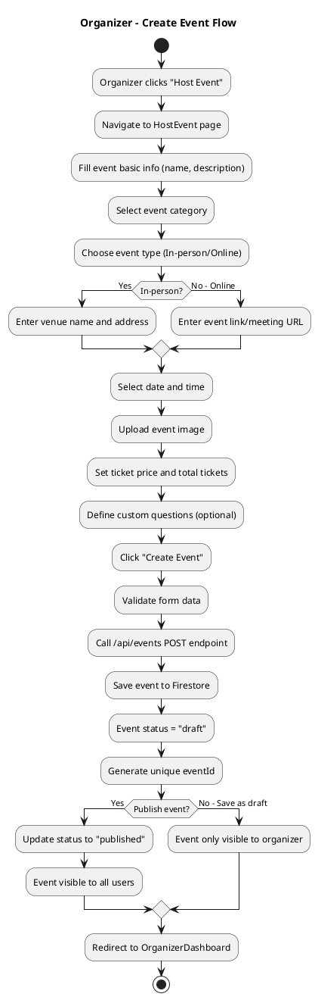

---

## 5. Organizer Dashboard & Management

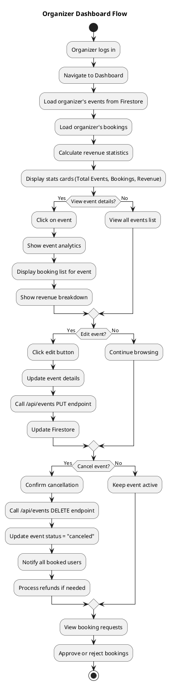

---

## 6. Organizer Verification (KYC)

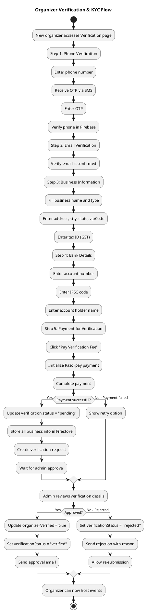

---

## 7. User Profile Management

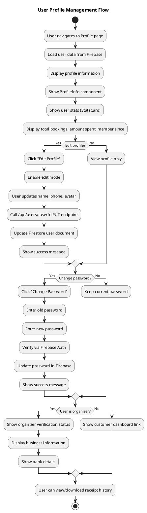

---

## 8. My Bookings & History

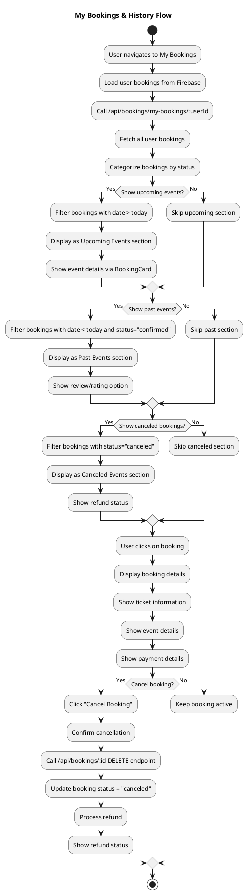

---

## 9. Complete User Journey (End-to-End)

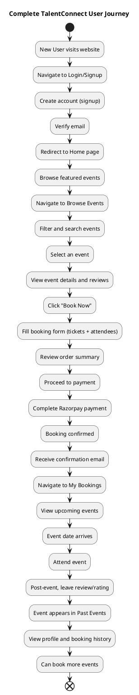

---

## 10. Organizer Complete Journey

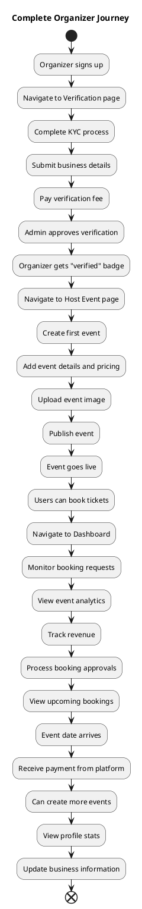

---

## 11. Admin Payment Processing

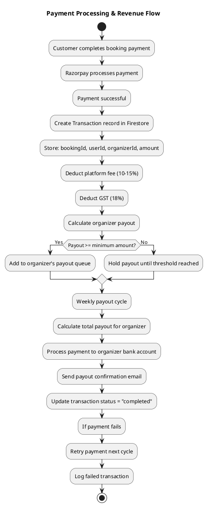

---

## 12. Real-Time Notifications

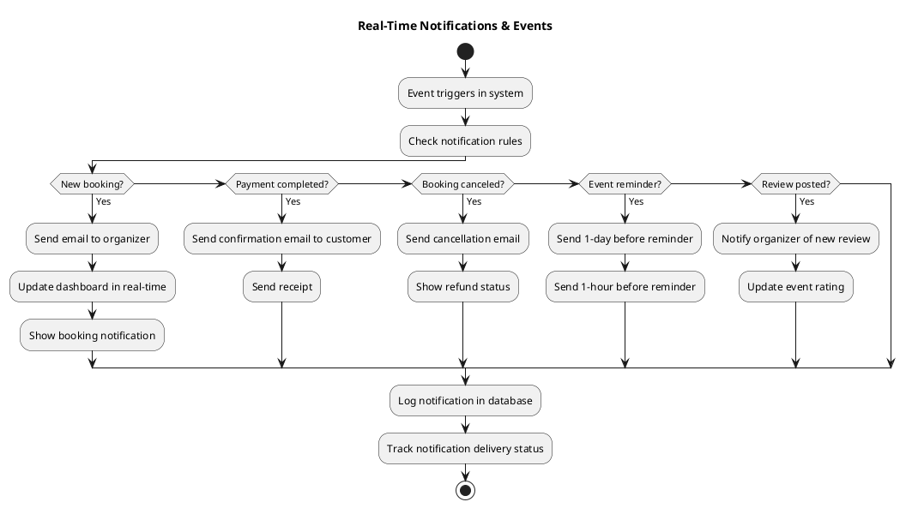

---

## How to Use These PlantUML Diagrams

### Option 1: PlantUML Online Editor
1. Visit: https://www.plantuml.com/plantuml/uml/
2. Paste any diagram code from above
3. Click "Submit"
4. View and export diagram

### Option 2: VS Code Extension
1. Install PlantUML extension: `jebbs.plantuml`
2. Copy diagram code into `.puml` or `.plantuml` file
3. Right-click → "Preview Diagram"
4. Export as PNG/SVG

### Option 3: Local PlantUML
```bash
# Install PlantUML
npm install -g plantuml

# Generate diagram
plantuml diagram.puml -o output/
```

### Option 4: Mermaid Syntax (Alternative)
If you prefer Mermaid instead of PlantUML, these can be converted to Mermaid syntax.

---

## Customization Tips

- **Change colors**: Add `!theme default` or custom theme
- **Adjust layout**: Use `skinparam` for positioning
- **Add notes**: Use `note left/right/top/bottom`
- **Highlight paths**: Use `if` conditions to show decision branches
- **Add actors**: Define swimlanes for different users (customer, organizer, admin)

---

## Example with Actors (Swimlanes)

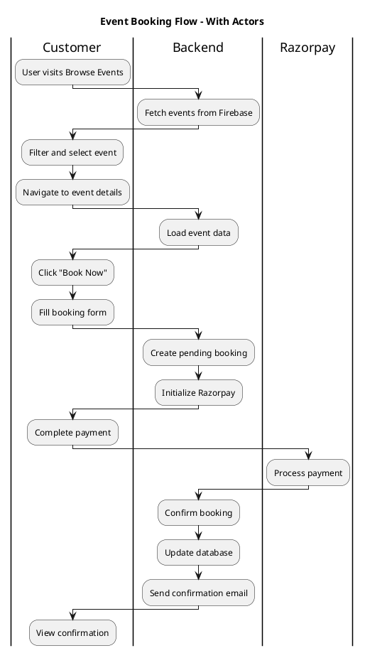

---

**Copy any diagram code above and paste into PlantUML editor to visualize!**
